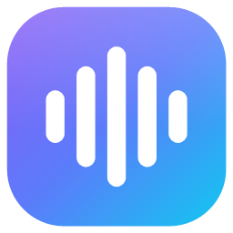
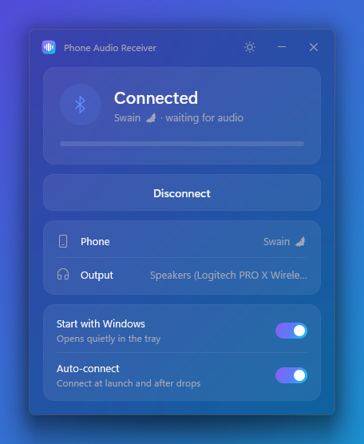
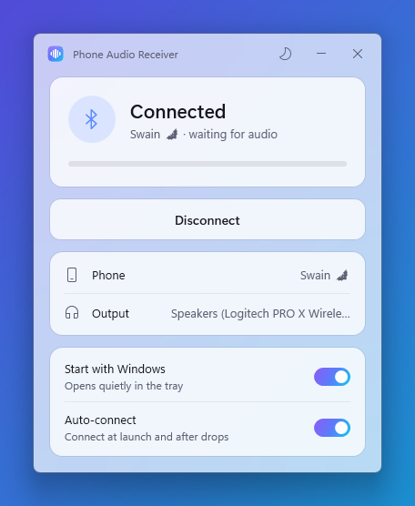

<div align="center">



# Phone Audio Receiver

**Hear your iPhone or Android phone through your PC headphones, over Bluetooth.**<br/>
A tiny Windows tray app that stays out of your way while you game.

[](https://github.com/mayyasbanat3-sudo/PhoneAudioReceiver/releases/latest)
[](#requirements)
[](#requirements)
[](https://dotnet.microsoft.com/)
[](LICENSE)

[](https://instagram.com/mayyas.banat)
[](https://wa.me/972594629259)




[**Download**](https://github.com/mayyasbanat3-sudo/PhoneAudioReceiver/releases/latest) ·
[Changelog](CHANGELOG.md) ·
[بالعربي](#بالعربي)

</div>

---

## Why

Watching TikTok or YouTube on your phone while gaming usually means taking your headset off.
Phone Audio Receiver turns your PC into a Bluetooth speaker for your iPhone or Android phone:
the phone's sound plays in your PC headphones, mixed with your game.

It does one thing, quietly, with **zero CPU use while it sits in the tray**.

## Features

- 🎧 **Phone audio in your PC headphones**: TikTok, YouTube, music, anything with sound.
- 📱 **iPhone and Android**: works with any phone that streams standard Bluetooth audio (A2DP).
- 🔁 **Auto-connect and auto-reconnect**: at launch, after the phone drops, and after the PC wakes from sleep.
- 📊 **Phone-only level meter**: shows the phone's audio, never your game's.
- 🌗 **Light and dark themes** with a one-click toggle.
- 🪟 **Windows 11 design**: acrylic backdrop, Segoe UI Variable, Fluent icons.
- 🟢 **Status at a glance**: a coloured dot on the tray icon.
- 🪶 **Featherweight**: 0 % CPU in the tray, no GPU use, no scanning, no internet, no phone app.

## How it works

Windows 10 (2004) and later include a Bluetooth A2DP *sink*, the part that receives audio.
Phone Audio Receiver asks Windows to open that link through the
`Windows.Media.Audio.AudioPlaybackConnection` API. From there, **Windows itself** receives,
decodes and plays the audio on your default output device.

```
 Phone ──A2DP (AAC/SBC)──▶ Bluetooth adapter ──▶ Windows A2DP sink ──▶ default output ──▶ headphones
                                                       ▲
                                     Phone Audio Receiver opens, keeps and restores the link
```

Because the app never touches the audio samples, it adds **no latency** and **cannot cause
crackling**. Bluetooth audio itself has about 150–250 ms of delay; iOS and Android delay video by
the same amount, so lip-sync in TikTok and YouTube stays correct. Your game audio does not go through
this path and is not delayed at all.

## Download

1. Grab `PhoneAudioReceiver-vX.Y.Z.zip` from the
   [latest release](https://github.com/mayyasbanat3-sudo/PhoneAudioReceiver/releases/latest).
2. Extract it anywhere and run `PhoneAudioReceiver.exe`. Nothing else to install: .NET is built in.
3. If SmartScreen says *"Windows protected your PC"*, choose **More info → Run anyway**
   (the exe is not code-signed).

## Requirements

- Windows 11, or Windows 10 version 2004 or later (no acrylic backdrop on Windows 10)
- A Bluetooth adapter (built-in or USB)
- An iPhone or Android phone

> **Tested on:** iPhone. Android phones use the same standard Bluetooth audio profile (A2DP), so
> they work the same way; Android testing is in progress. Tried it on your phone? Let me know in an
> [issue](https://github.com/mayyasbanat3-sudo/PhoneAudioReceiver/issues) or on Instagram.

## Usage

1. Pair the phone once: **Settings → Bluetooth & devices → Add device**.
2. Start Phone Audio Receiver. It connects to the phone automatically.
3. Play something on the phone. The status turns green: **Receiving audio**.
4. Close the window. The app keeps running in the tray; right-click the tray icon → **Exit** to quit.

| Tray dot | Meaning |
|---|---|
| 🟢 Green | Receiving audio |
| 🔵 Blue | Connected, phone is silent |
| 🟠 Amber | Connecting or reconnecting |
| 🔴 Red | Connection failed |
| ⚪ Grey | Disconnected |

## Performance

Measured on Windows 11 with an iPhone connected:

| Situation | CPU | Memory (private) |
|---|---|---|
| Hidden in the tray, connected | **0 ms per 30 s** | ~56 MB |
| Window open, level meter running | ~0.3 % of one core | ~70 MB |

The window renders on the CPU in software mode, so the app never competes with games for the GPU.
The level meter only runs while the window is visible.

## Troubleshooting

**Audio cuts out or crackles.** The app does not process audio, so dropouts come from the
Bluetooth link. The usual causes:

- The Bluetooth dongle sits next to other 2.4 GHz radios (Wi-Fi dongle, wireless headset or mouse
  receivers). Move it away, ideally on a short USB extension cable on your desk.
- It is plugged into a USB 3.0 port, which emits 2.4 GHz noise. Try a USB 2.0 port.
- Power saving switches it off: **Device Manager → Bluetooth adapter → Power Management →**
  untick *Allow the computer to turn off this device*.

**Sound suddenly turns low quality.** The phone switched to the Hands-Free (call) profile,
often because an app picked the phone as a microphone. If you only need media audio:
**Control Panel → Devices and Printers → your phone → Properties → Services →** untick
*Handsfree Telephony*.

**"No phone found".** Pair the phone in Windows Bluetooth settings first.

## Build from source

Requires the [.NET 8 SDK](https://dotnet.microsoft.com/download/dotnet/8.0).

```bash
git clone https://github.com/mayyasbanat3-sudo/PhoneAudioReceiver.git
cd PhoneAudioReceiver/src/PhoneAudioReceiver
dotnet build -c Release
```

Single-file exe with .NET built in:

```bash
dotnet publish -c Release -r win-x64 --self-contained true -p:PublishSingleFile=true -p:IncludeNativeLibrariesForSelfExtract=true -p:EnableCompressionInSingleFile=true -p:DebugType=none -o dist
```

Regenerate the icon after changing its design (from `src/PhoneAudioReceiver`):

```bash
powershell -ExecutionPolicy Bypass -File tools/make-icon.ps1 -Png ../../docs/images/icon.png
```

## Project structure

```
src/PhoneAudioReceiver/
├── Program.cs              Entry point, single instance, software rendering
├── ConnectionManager.cs    Bluetooth link: connect, auto-reconnect, sleep/resume
├── AudioEndpoints.cs       Core Audio: output device name, phone-only level
├── MainWindow.xaml(.cs)    Window layout and behaviour
├── Theme.cs                Theme switching, Windows 11 acrylic and window effects
├── Themes/                 Dark and light palettes, control styles
├── Tray.cs                 Tray icon, status dot, themed menu
├── Settings.cs             Saved settings and "Start with Windows"
├── Assets/AppIcon.ico      App icon (16–256 px)
└── tools/make-icon.ps1     Icon generator
```

## Author

<table>
  <tr>
    <td></td>
    <td>
      <b>Mayyas Banat</b><br/>
      Designed and built Phone Audio Receiver.<br/>
      <a href="https://instagram.com/mayyas.banat">Instagram @mayyas.banat</a> ·
      <a href="https://wa.me/972594629259">WhatsApp +972 594 629 259</a>
    </td>
  </tr>
</table>

Questions, ideas or bug reports: open an [issue](https://github.com/mayyasbanat3-sudo/PhoneAudioReceiver/issues)
or reach me on Instagram.

## License

[MIT](LICENSE) © 2026 **Mayyas Banat**.
You may use, modify and share this project, as long as the copyright notice and the license are kept.

---

## بالعربي

**Phone Audio Receiver** تطبيق صغير لويندوز بيشغّل صوت جوالك، آيفون أو أندرويد (تيك توك، يوتيوب،
موسيقى)، على سماعة الكمبيوتر عبر البلوتوث، لحتى ما تضطر تشلح السماعة وانت عم تلعب.

- **التحميل:** نزّل الملف المضغوط من صفحة
  [الإصدارات](https://github.com/mayyasbanat3-sudo/PhoneAudioReceiver/releases/latest)، فك الضغط، وشغّل
  `PhoneAudioReceiver.exe`. ما بيحتاج تثبيت أي شي.
- **أول مرة:** اربط جوالك بالكمبيوتر من إعدادات البلوتوث، وبعدها التطبيق بيتصل لحاله.
- **الجوالات:** آيفون وأندرويد. انجرّب على آيفون، وتجربة أندرويد قيد التنفيذ.
- **خفيف:** ما بيستهلك معالج وهو بالخلفية، وما بيستخدم كرت الشاشة أبداً.
- **التصميم:** واجهة ويندوز 11 شبه شفافة، مع وضع فاتح وداكن.

تصميم وبرمجة **Mayyas Banat**.
للتواصل: [انستغرام @mayyas.banat](https://instagram.com/mayyas.banat) ·
[واتساب ‎+972 594 629 259](https://wa.me/972594629259)

جميع الحقوق محفوظة © 2026 Mayyas Banat. الكود منشور برخصة MIT، يعني بتقدر تستخدمه وتعدّل
عليه بشرط تضل حقوق المؤلف والرخصة موجودة.
